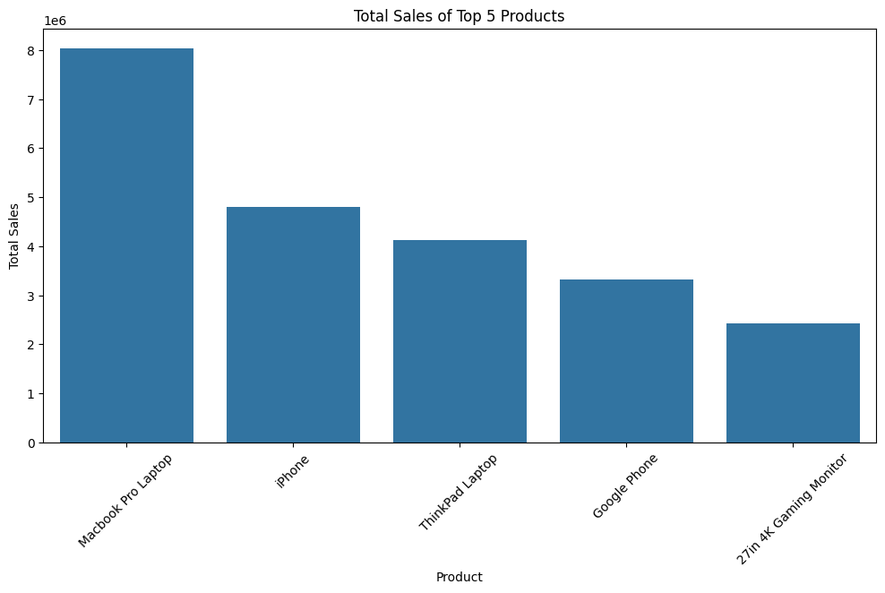
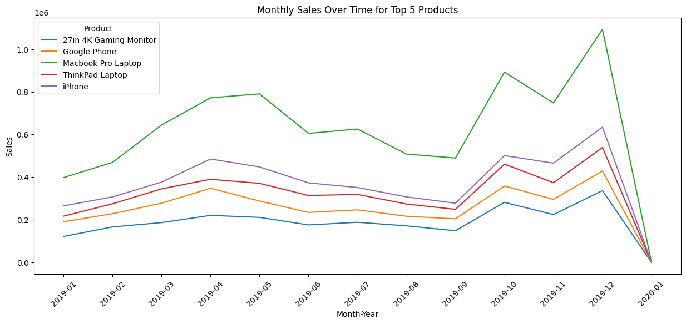
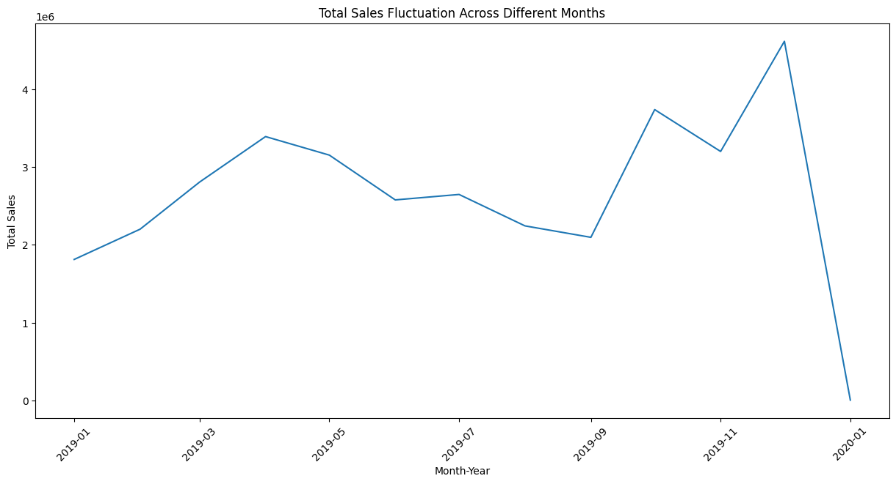
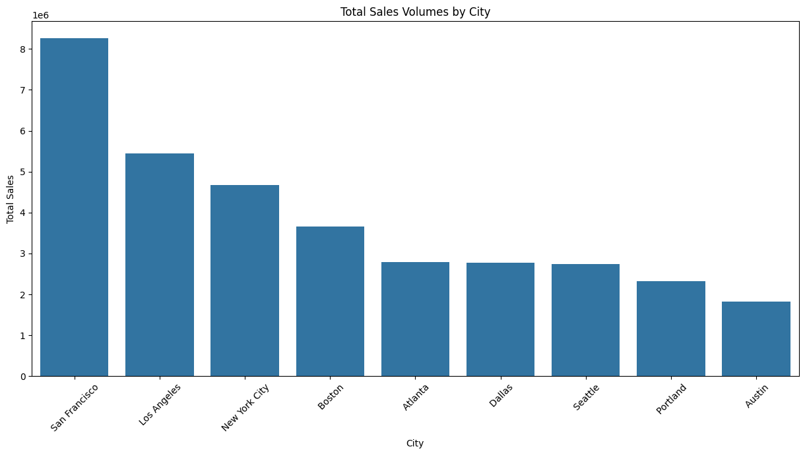
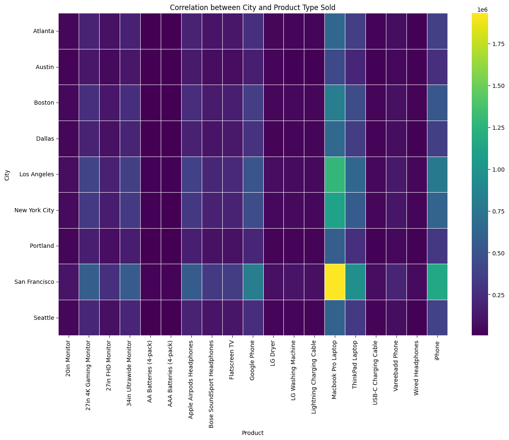
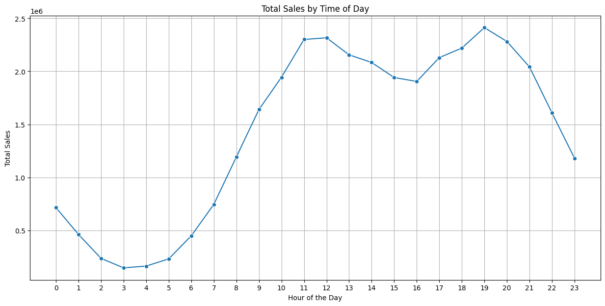
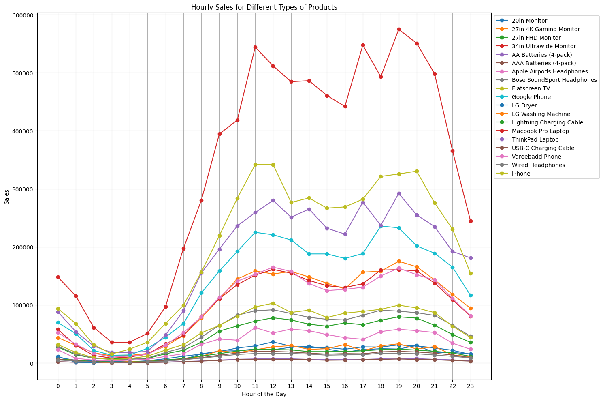
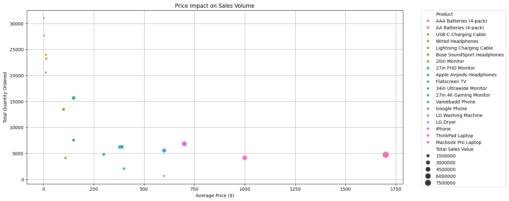
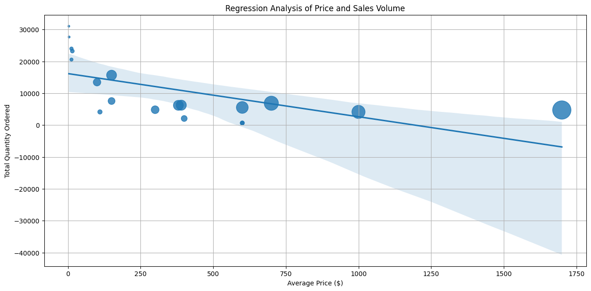

# Market Trend Analysis: Sales Data

Exploratory analysis of 2019 sales records from an electronics retailer. It looks at which products sell most, how demand changes by month, city and hour of the day, and how price relates to the quantity ordered. The analysis uses pandas, Matplotlib and seaborn in a Jupyter notebook.

**Highlights**

- The Macbook Pro Laptop generates the most revenue, followed by the iPhone and the ThinkPad Laptop.
- Sales build through the year and peak in December.
- San Francisco is the largest market by a clear margin, followed by Los Angeles and New York City.
- Orders peak around 12 PM and 7 PM.
- Cheaper accessories sell in far higher quantities, but premium products drive total revenue.

## Dataset

[Sales Data Analysis on Kaggle](https://www.kaggle.com/datasets/beekiran/sales-data-analysis) (file: `Sales Data.csv`). It isn't included in this repo. Download it from Kaggle and place it next to the notebook.

## How to run

```bash
git clone https://github.com/humzagk/Market-Trend-Analysis-Examine-sales-data-to-identify-trends.git
cd Market-Trend-Analysis-Examine-sales-data-to-identify-trends
pip install -r requirements.txt jupyter
# put "Sales Data.csv" in this folder, then:
jupyter notebook Market_Trend_Analysis_Examine_sales_data_to_identify_trends_and_predict_future_demand.ipynb
```

You can also run the analysis as a plain script with `python market_trend_analysis_examine_sales_data_to_identify_trends_and_predict_future_demand.py`, or open the notebook in Google Colab and upload the CSV there. A PDF export of the notebook with all charts is included as well.

## Research questions

1. **Product performance**: which products have the highest sales, and how do they change over time?
2. **Seasonal demand**: how do sales change from month to month?
3. **Geography**: which cities sell the most, and do product preferences differ by city?
4. **Time of day**: when are sales highest, and does this differ by product?
5. **Price sensitivity**: how does price affect the quantity sold?

## 1. Product Performance Analysis

*Which products have the highest sales, and what patterns can be observed in their sales over time?*





Based on the bar chart, the product with the highest sales is the "Macbook Pro Laptop". The iPhone follows as the second highest in total sales, with the "ThinkPad Laptop" not far behind. The "Google Phone" and "27in 4K Gaming Monitor" have lower total sales compared to the top three products.
From the line chart depicting sales over time, several patterns emerge:

1. Seasonal Trends: There seems to be a significant peak in sales for the "Macbook Pro Laptop" towards the end of the year, likely corresponding with the holiday season. This suggests a strong seasonal influence on sales, possibly due to holiday promotions or gift purchasing behavior.

2. Consistency in Demand: The iPhone shows a relatively consistent demand over the year with slight increases around the same time as the Macbook, again possibly due to holiday sales.

3. Growth and Decline: Some products show a growth in sales over certain months, followed by a decline. This could be related to product launches, marketing campaigns, or changes in consumer preferences.

4. Abrupt Changes: The sharp decline in sales for all products at the end of the timeframe may indicate data cutoff or a significant market event.

In summary, the "Macbook Pro Laptop" leads in total sales with evident seasonal peaks, while other products show varying degrees of consistency and seasonal influence. To further this analysis, we could investigate external factors affecting these trends, like marketing campaigns, product releases, or broader economic factors.

## 2. Seasonal Demand Trends

*How do sales fluctuate across different months? Are there any specific months where sales peak or dip significantly?*



From the line chart we can infer the following about seasonal demand trends:

1. General Trend: There is a clear trend of sales increasing towards the end of the year.

2. Sales Peak: The most significant peak in sales occurs in the month of December. This is typical for retail due to the holiday season, where customers make more purchases for gifts and take advantage of holiday sales.

3. Mid-Year Sales: There is a slight increase in sales around mid-year, which could be attributed to summer promotions or other seasonal factors.

4. Sales Dip: After the peak in December, there is a sharp decline in January. This pattern is common in retail due to a post-holiday decrease in consumer spending.

The data suggests that there are significant seasonal fluctuations in sales, with the end of the year being particularly strong for sales. We can use this information to plan company inventory and marketing strategies accordingly, to capitalize on high-demand periods and prepare for slower sales months.

## 3. Geographical Sales Trends

*Which cities have the highest sales volumes? Is there a correlation between the city and the type of product sold?*





Geographical Sales Trends:

1. Highest Sales Volumes by City:
   - San Francisco has the highest sales volume by a significant margin.
   - Los Angeles and New York City follow as the second and third highest in sales volumes.
   - Other cities like Boston, Atlanta, Dallas, Seattle, Portland, and Austin have lower sales volumes in comparison.

2. Correlation between City and Product Type:
   - The heatmap indicates varying sales volumes for different products across cities.
   - Certain cities have distinct preferences for specific products. For instance, there's a noticeable concentration of sales for a particular product (highlighted in yellow on the heatmap) in San Francisco, which could be indicative of a higher demand for that product in that city.
   - The overall pattern suggests that while some cities may show a preference for certain types of products, most cities exhibit a diversified product sales portfolio.

From these observations, we can infer that location-specific marketing strategies and inventory stocking could be optimized based on the sales volumes and product preferences in each city. For example, in cities with high sales volumes for specific products, marketing efforts could be increased for those products, or related accessories and services could be offered to capitalize on the demand.

## 4. Time-of-Day Analysis

*At what times of the day are sales highest? How does this vary for different types of products?*





Based on the graphs, the inferences regarding the time-of-day analysis are:

1. Sales Volume by Time of Day:
   - The graph titled "Total Sales by Time of Day" shows that sales are lowest early in the morning (1 AM to 6 AM).
   - Sales start to increase significantly from 6 AM, peaking at 12 PM, suggesting that late morning to early afternoon is the busiest sales period.
   - There is a second peak around 7 PM, indicating another busy period likely coinciding with people finishing work.
   - Sales then decline after 7 PM, with a sharp drop after 9 PM as it gets closer to midnight.

2. Variation for Different Types of Products:
   - The "Hourly Sales for Different Types of Products" graph illustrates that different products have different peak times.
   - High-value items like laptops (Macbook Pro and ThinkPad) show significant sales during the mid-day peak.
   - Smaller items like batteries and cables have more consistent sales throughout the day, with slight increases in the evening.
   - Some products, such as the "20in Monitor" and "27in 4K Gaming Monitor," exhibit a distinct peak in the evening, possibly reflecting when customers are likely to shop for home electronics.

These insights suggest that the time-of-day shopping patterns vary by product type, likely influenced by customer routines and the nature of the product. We could use this information to tailor our staffing levels, targeted promotions, and stock availability to match the times when specific products are most likely to be purchased.

## 5. Price Impact on Sales Volume

*How does the price of products affect their sales volume? Are there any trends indicating price sensitivity among different product categories?*





From the charts "Regression Analysis of Price and Sales Volume" and "Price Impact on Sales Volume," we can infer the following about the price impact on sales volume and price sensitivity:

1. Negative Correlation: There is a negative correlation between price and sales volume, as indicated by the downward slope of the regression line. This suggests that as the price of a product increases, the quantity ordered tends to decrease.

2. Price Sensitivity: The size of the circles in the scatter plot represents the total sales value, with larger circles denoting higher sales values. Products like the "Macbook Pro Laptop" and "iPhone," despite their higher prices, have contributed significantly to the total sales value, indicating that certain high-value products maintain a substantial sales volume despite higher prices.

3. Different Product Categories: The scatter plot shows a range of products across different price points. Lower-priced items, like charging cables and batteries, have a high quantity ordered, which indicates a lower price sensitivity. In contrast, more expensive products, such as laptops and smartphones, have lower quantities ordered but maintain high total sales value, suggesting a different type of price sensitivity where consumers may be willing to spend more for premium products.

4. Product-Specific Trends: Each product category may have its own price elasticity. For example, consumer electronics like smartphones and laptops may have a certain threshold of willingness to pay, beyond which sales volume might drop sharply. Conversely, essential accessories or lower-priced items may have less price elasticity due to their necessity or lower investment risk.

These trends can provide valuable insights for pricing strategies, indicating that while price increases can lead to lower quantities sold, this doesn't necessarily result in lower total sales value, especially for premium or highly desired products. It also highlights the importance of understanding the price elasticity of different product categories when making pricing decisions.

## Notes and limitations

- The analysis is descriptive. It identifies trends and seasonality but doesn't fit a forecasting model, so "predict future demand" refers to what the trends suggest rather than to a trained predictor.
- The final point on the monthly charts (January 2020) is near zero. That is consistent with the data ending in early January 2020 rather than a real collapse in sales.
- The data covers one year from one retailer, so the seasonal patterns are based on a single cycle.

## Repository contents

| File | Description |
|------|-------------|
| `Market_Trend_Analysis_...ipynb` | Main notebook with code, charts and saved output |
| `market_trend_analysis_...py` | The same analysis exported as a Python script |
| `Market Trend Analysis; ...pdf` | PDF export of the notebook |
| `images/` | Charts used in this README, taken from the notebook output |
| `requirements.txt` | Python dependencies |

## License

[MIT](LICENSE)
